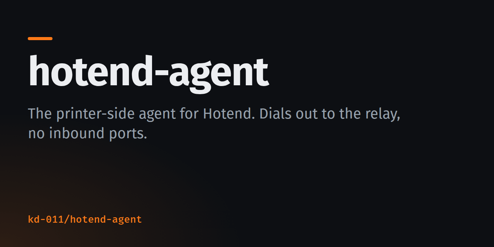
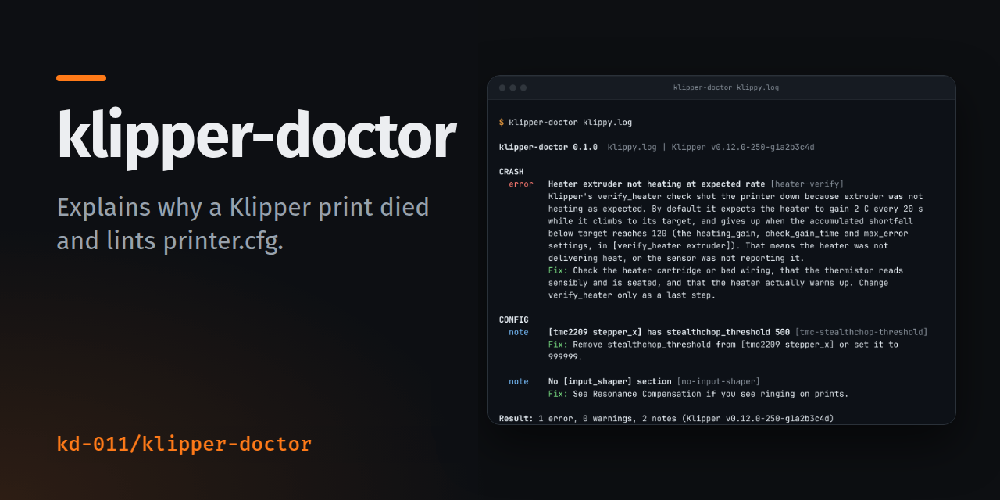
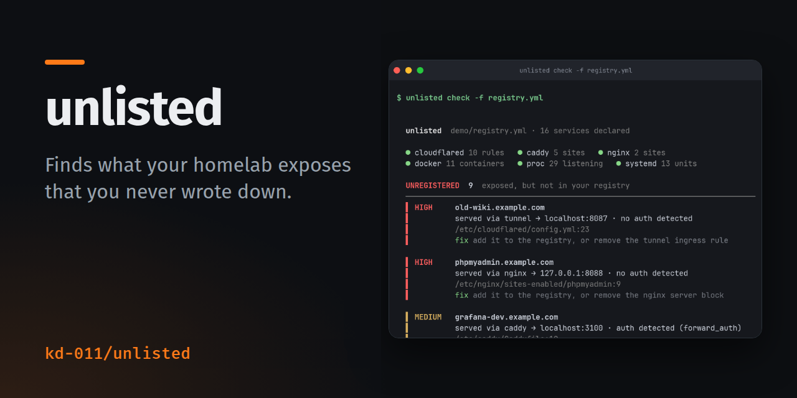

There were no good 3D printer apps and I got sick of waiting for one, so I built [Hotend](https://hotend.app). So much more came out of the same impatience.

<table>
  <tr>
    <td width="50%">
      
    </td>
    <td width="50%">
      
    </td>
  </tr>
  <tr>
    <td width="50%">
      
    </td>
    <td width="50%">
      
    </td>
  </tr>
</table>

| | | |
| --- | --- | --- |
| [**hotend-agent**](https://github.com/kd-011/hotend-agent) | The bit of [Hotend](https://hotend.app) that runs on your printer. Published so you can read what it does. | Go |
| [**klipper-doctor**](https://github.com/kd-011/klipper-doctor) | Paste a `klippy.log`, get told why Klipper stopped and what to try. Also an [MCP server](https://github.com/kd-011/klipper-doctor-mcp) for agents. | JS |
| [**mint**](https://github.com/kd-011/mint) | Self-hosted budgeting using the open banking API, or CSV import. One SQLite file, ATO deduction tags. | JS |
| [**au-bizdays**](https://github.com/kd-011/au-bizdays) | Business days and deadlines with the right public holidays for each Australian state. CLI and MCP. | JS |
| [**unlisted**](https://github.com/kd-011/unlisted) | Diffs what your homelab exposes against what you wrote down, and shows the gap. | Go |
| [**restore-drill**](https://github.com/kd-011/restore-drill) | Restores your newest backup somewhere safe, checks it, and tells you when it fails. | JS |
| [**worktree-preview**](https://github.com/kd-011/worktree-preview) | One command to run any git worktree's dev server on its own port. | JS |
| [**dossier-scribe**](https://github.com/kd-011/dossier-scribe) | Points at the sentence in your docs that went stale when the file it cites changed. | JS |
| [**couchbox**](https://github.com/kd-011/couchbox) | 15 party games for one room. Everyone joins on their phone, no app, no accounts. | JS |

I'm learning to read and write what the agents produce: Python first, then JavaScript and Go, since that's what the above is written in. If you spot something in my code a beginner shouldn't copy, open an issue. I'd rather know.
